<div align="center">


# Brim

**Your Claude Code sessions, in the notch.**

Brim turns the black strip at the top of your MacBook into a command center for Claude Code: what every session is doing, which one needs you, and Allow or Deny without leaving what you're working on. Your calendar, tasks, weather, music and a file shelf are there too.

[](https://github.com/Neel-Sh/Mac-Notch/actions/workflows/ci.yml)


[](LICENSE)

[Install](#install) · [Features](#features) · [Settings](#make-it-yours) · [How it works](#how-it-works) · [Privacy](#privacy)

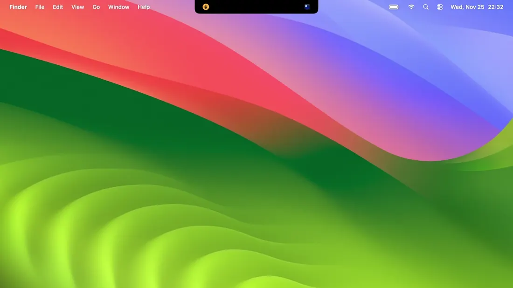

<sub>Recorded in Brim's demo mode, so every name, project and event is made up. <a href="assets/demo.mp4">Watch it in full quality.</a></sub>

</div>

---

## Why

Claude Code is at its best when you hand it something and go do something else. Then it stops to ask permission for a command, and you don't notice for twenty minutes. Brim watches every session on your Mac, from the terminal, your editor or the Claude app, and taps you on the shoulder from the one place on the screen that's always visible and never in the way.

## Install

Brim doesn't have a signed download yet, so you build it yourself. It takes about a minute.

**You need**

- A Mac running **macOS 26 or later**. A notch is best, but Brim also works without one.
- **Xcode 26 or later**, from the App Store.
- **[Claude Code](https://claude.com/claude-code)**, for the Agents tab. Everything else works without it.

**1. Build and install**

```bash
git clone https://github.com/Neel-Sh/Mac-Notch.git
cd Mac-Notch
scripts/install.sh
```

This builds Brim, copies `Brim.app` into `/Applications` and opens it. Brim has no Dock icon and no window: look for the half-capsule icon in the menu bar, and move the pointer to the notch.

Prefer Xcode? Open `Brim.xcodeproj` and press ⌘R.

**2. Turn on approvals**

Open the island, go to **Agents** and press **Turn On**. This adds the one hook that lets Brim show what each session is doing and answer permission requests. Sessions you start after that will use it. [How it works](#how-it-works) says exactly what it changes.

**3. Keep it running**

Open **Settings** from the menu bar icon and turn on **Open at login**.

### Permissions Brim asks for

Each one is asked for the first time you use the page that needs it. Say no and the rest of Brim still works.

| Permission | When | Why |
| --- | --- | --- |
| Location | First time you open Weather | The forecast where you are |
| Calendars | First time you open Calendar | Your events |
| Automation (Music, Spotify) | First time a track plays | Artwork and playback controls |
| Accessibility (optional) | Never asked for. Grant it yourself if you want it. | Raising the exact window a session runs in, not just its app |

### Updating

```bash
git pull
scripts/install.sh
```

A build you make yourself is signed for your Mac only, so after an update macOS may ask for Calendar and Location again.

### Uninstalling

1. In **Settings → Claude Code**, turn off **Live detail and approvals**. This removes the hook from `~/.claude/settings.json`.
2. Quit Brim from its menu bar icon and delete `/Applications/Brim.app`.
3. To remove your tasks, shelf and settings as well:

```bash
rm -rf ~/Library/Application\ Support/Brim && defaults delete com.neelsharma.brim
```

## Features

### 🤖 Agents: every session at a glance

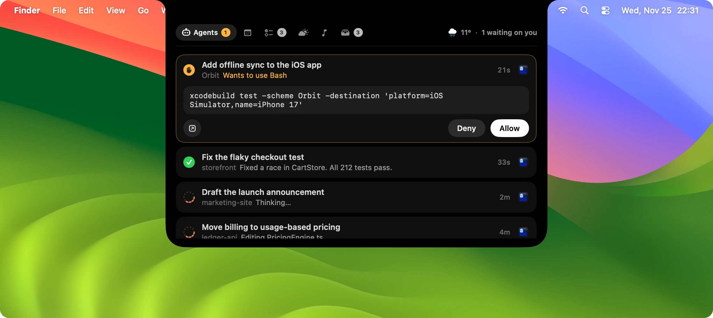

Each Claude Code session shows its title, its project, and what it's doing right now ("Editing PricingEngine.ts", "Thinking…"). A clock shows how long the current turn has been running. Whatever needs you sorts to the top.

- **No setup.** Brim reads the session files Claude Code already keeps, so sessions appear the moment you start `claude`.
- **Jump to it.** Click a session to bring its terminal, editor or Claude window to the front.
- **Swipe to hide.** Two fingers left on a row hides a session you don't care about. It comes back when it starts working or needs you.
- **The status marks** keep one round shape for every state: an outline when idle, a turning ring while working, amber when it needs you, a green check when it's done. "Done" fades back to idle after a minute, or once you've seen it.

### ✋ Approvals from the notch

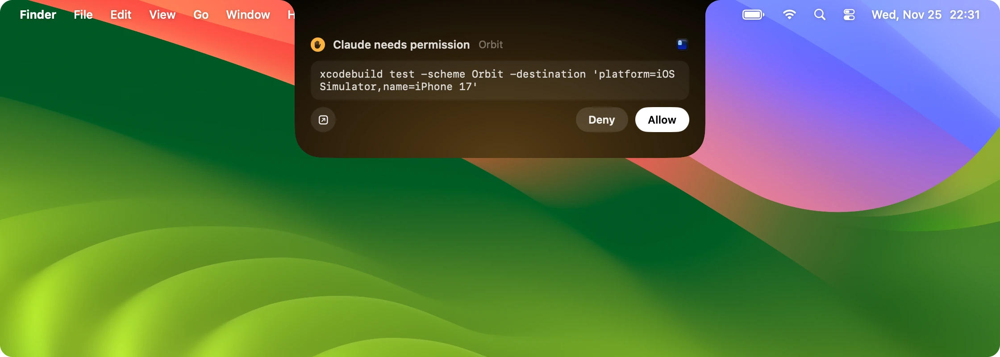

When a session asks permission, the notch opens just enough to show the exact command, glowing amber, with **Allow** and **Deny**. Single-choice questions from Claude appear as buttons you can click. Answer in the terminal instead and the notch steps aside on its own.

Approvals come from a small hook that you turn on with one click. See [How it works](#how-it-works).

### 🏝️ Live activity beside the notch

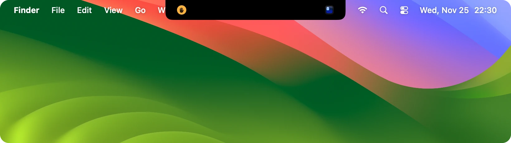

Closed, the island grows just past the notch to show the most important thing going on: the lead session's state and what it's running, or how many sessions are waiting on you. With music playing, it shows the artwork and bars that move only while something is actually playing.

### 📅 Calendar

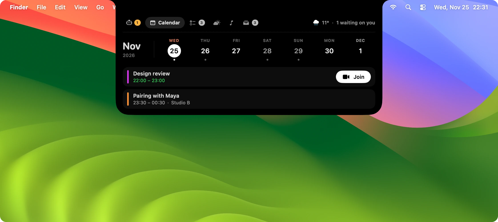

The week as a row of days, with dots on the days that have something on. Tap a day to see its events in each calendar's colour, with the meeting happening now marked live, and scroll when the day is full. Zoom, Meet, Teams and Webex invitations get a **Join** button. It reads every calendar the Mac's Calendar app shows.

### 🌧️ Weather

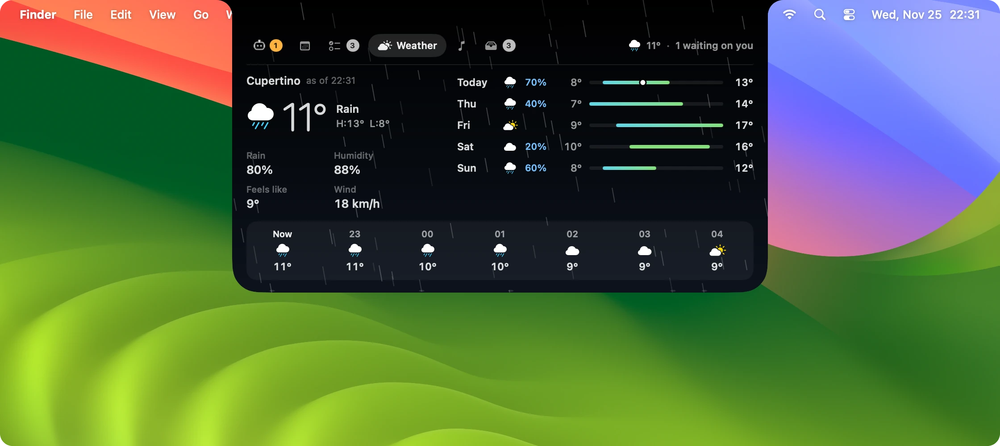

Current conditions, rain chance, humidity, feels-like and wind. Five days of temperature bars on one shared scale, coloured by temperature, with a dot on today's bar where it is right now. Below, the next seven hours.

The weather is drawn inside the island: rain falls and splashes on its bottom edge, snow drifts, mist rolls through, and clear nights twinkle. All of it holds still when Reduce Motion is on.

### ✅ Tasks

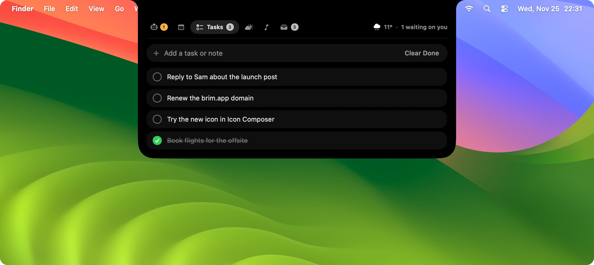

A quick place for notes and to-dos that doesn't need its own window. Type, press Return, check it off. Swipe or right-click to delete. Tasks survive a restart.

### 🎵 Music

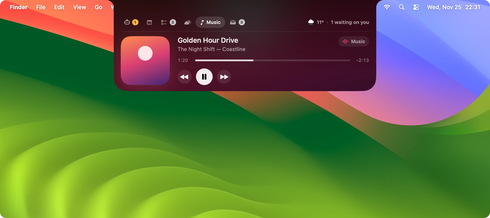

What's playing in Music or Spotify: artwork, title, artist and album, how far through the track you are, and playback controls. The island takes its tint from the artwork. Click the artwork to open the player.

### 📥 Shelf

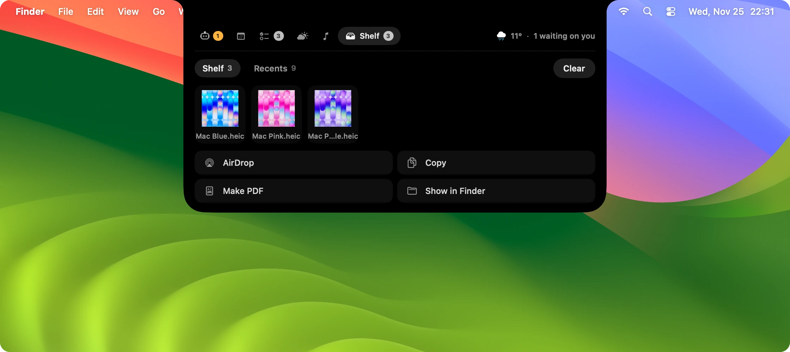

Drag files onto the notch and they wait on the shelf until you know where they go. AirDrop them, copy them, turn a stack of images into one PDF, or drag them back out. The shelf survives a restart.

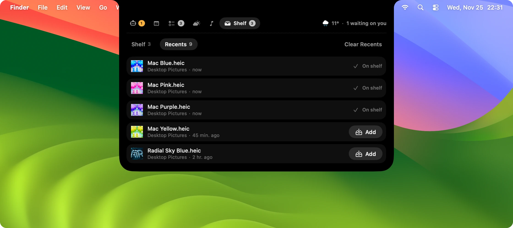

**Recents** remembers what has been on the shelf, so a file you cleared an hour ago is one click from coming back.

## Make it yours

<div align="center">

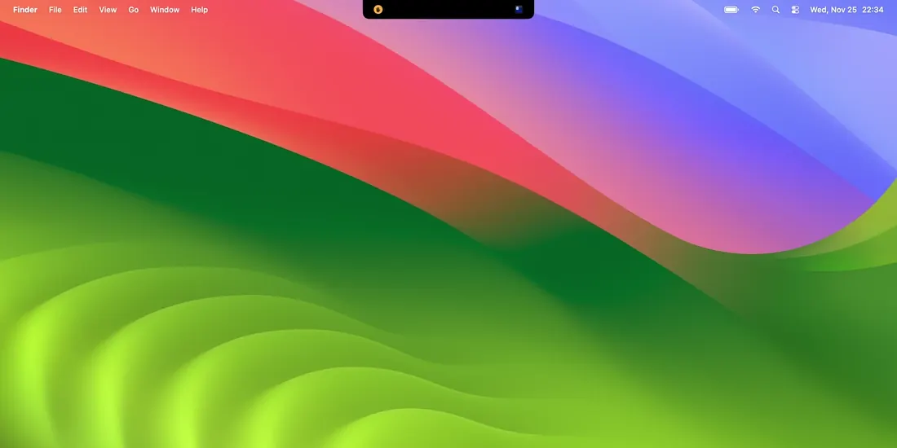

<sub>The island follows Settings as you change them. <a href="assets/customize.mp4">Watch it in full quality.</a></sub>

</div>

Settings is in the menu bar, under the half-capsule icon. Every change applies straight away, so you can watch the island restyle itself while the window is open.

<table>
<tr>
<td width="50%">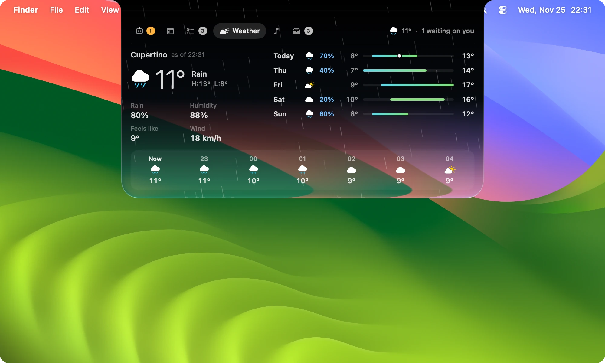<br><div align="center"><sub><b>Liquid Glass</b>: black at the bezel, clear toward its edge</sub></div></td>
<td width="50%">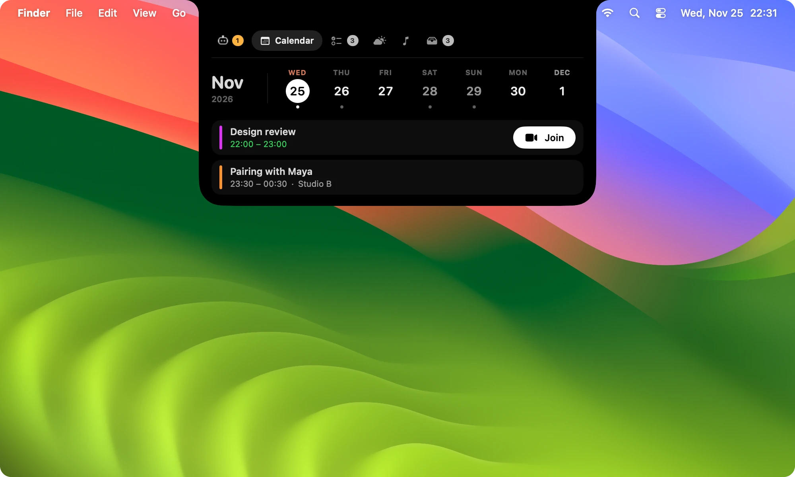<br><div align="center"><sub><b>Compact</b>: the same pages in less space</sub></div></td>
</tr>
<tr>
<td>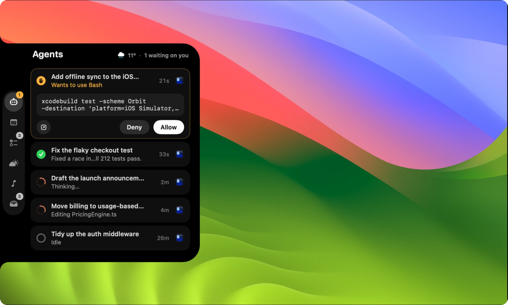<br><div align="center"><sub><b>Left edge</b>: a panel with its pages in a column</sub></div></td>
<td>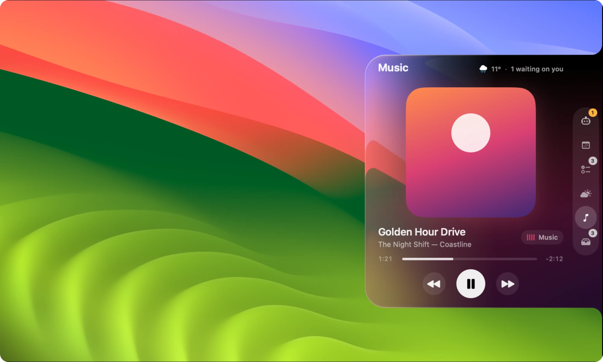<br><div align="center"><sub><b>Right edge</b>, here in Liquid Glass</sub></div></td>
</tr>
</table>

### Appearance

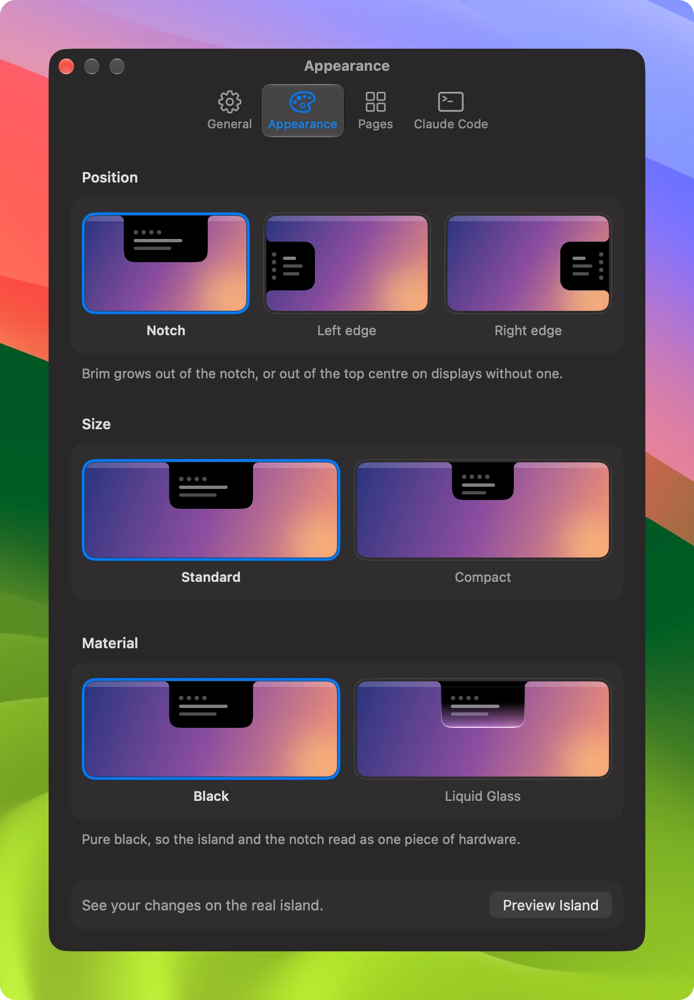

| Setting | Choices |
| --- | --- |
| **Position** | **Notch**, **Left edge** or **Right edge**. Docked to a side, Brim rests as a slim pill on the screen edge and grows into a panel. A slider sets how high on the screen it sits. |
| **Size** | **Standard** or **Compact**. |
| **Material** | **Black**, so the island and the notch read as one piece of hardware, or **Liquid Glass**. |

**Preview Island** opens the island so you can see the change on the real thing.

### General

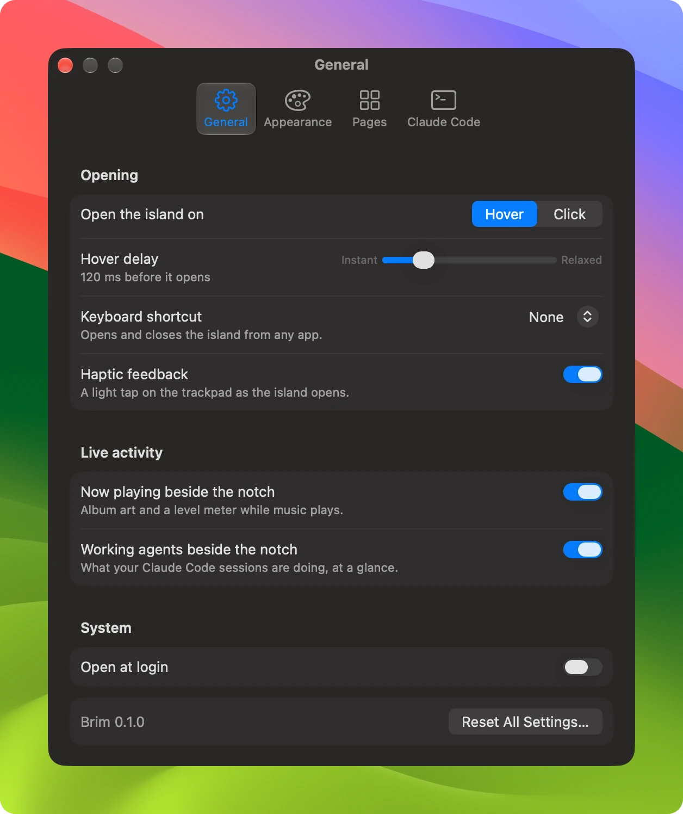

| Setting | What it does |
| --- | --- |
| **Open the island on** | **Hover** or **Click**. With Click, clicking anywhere else or pressing Esc closes it. |
| **Hover delay** | How long the pointer rests on the island before it opens, from instant to 600 ms. |
| **Keyboard shortcut** | Opens and closes the island from any app: ⌥⌘B, ⌃⌥Space or ⌃⌘N. Off by default. |
| **Haptic feedback** | A light tap on the trackpad as the island opens. |
| **Now playing beside the notch** | Album art and a level meter while music plays. |
| **Working agents beside the notch** | What your sessions are doing, at a glance. |
| **Open at login** | Starts Brim when you log in. |

**Reset All Settings…** puts appearance, position, pages and behaviour back to how Brim started. Your tasks, shelf and Claude Code hook stay as they are.

### Pages

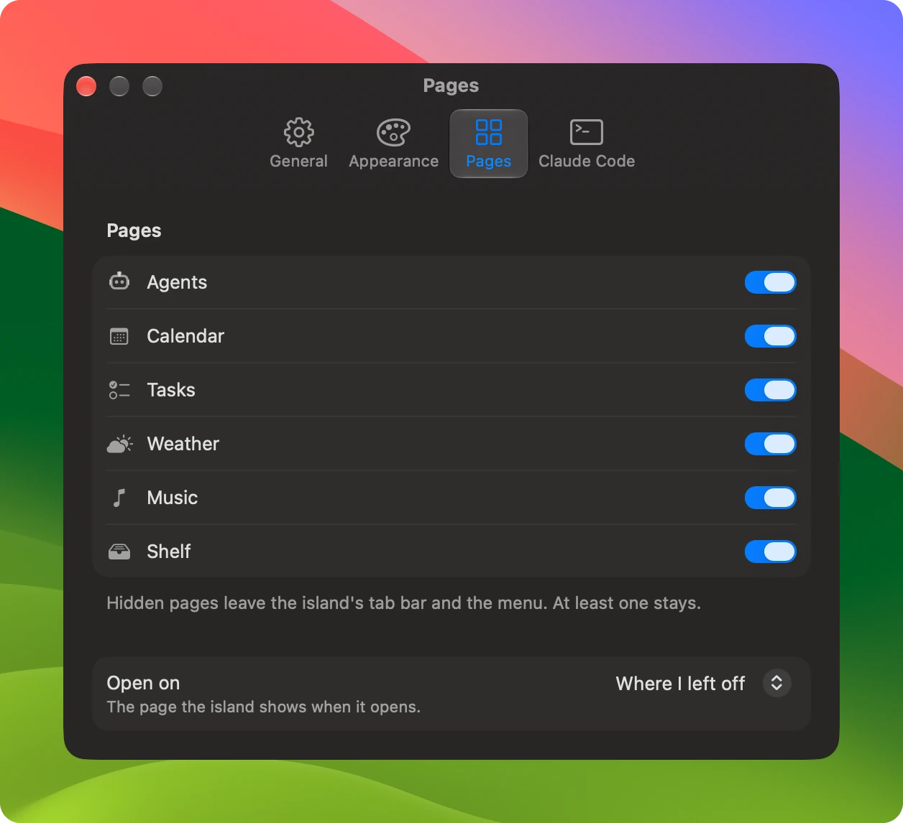

Switch off the pages you don't use and they leave the island's tab bar and the menu. At least one always stays.

**Open on** picks the page the island shows when it opens: a page of your choice, or wherever you left off.

### Claude Code

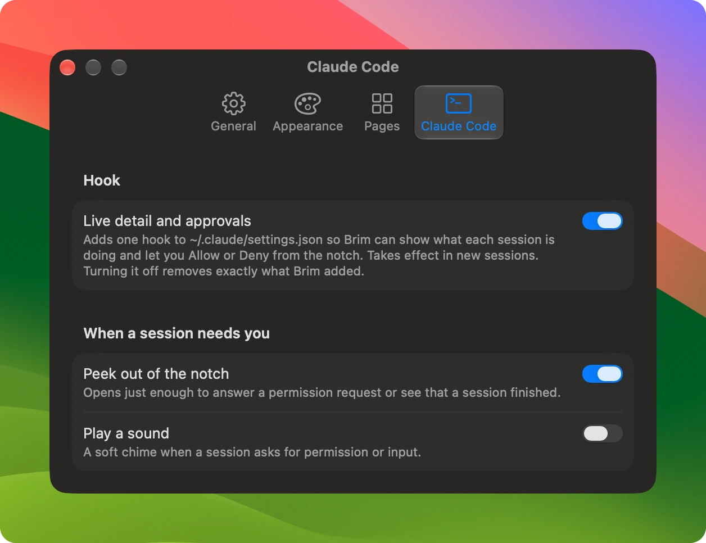

| Setting | What it does |
| --- | --- |
| **Live detail and approvals** | Adds or removes Brim's hook in `~/.claude/settings.json`. |
| **Peek out of the notch** | Opens just enough to answer a permission request or see that a session finished. |
| **Play a sound** | A soft chime when a session asks for permission or input. Off by default. |

## Made to feel like part of macOS

- **Physical motion.** The island opens and closes on critically damped springs, so it never wobbles. Content fades out before the shape shrinks, so text is never squeezed, and new content settles in from just above.
- **Forgiving pointer.** By default it opens after a 120 ms pause on the notch and closes only after the pointer has been away for 420 ms, so a brush past the edge doesn't snap it shut. It stays open while you type, and Escape closes it.
- **The real notch shape.** Brim is flush with the bezel, with continuous corners, and its top corners curve outward into the menu bar when open.
- **Never in the way.** Clicks next to the island pass straight through to the app underneath, and Brim never takes focus from the app you're using.
- **Accessible.** It respects Reduce Motion, controls have labels, and states use shape as well as colour.

## How it works

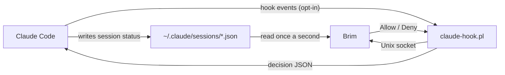

- **Session list.** Claude Code writes each live session's status to `~/.claude/sessions/<pid>.json`. Brim reads those files, so the session list needs no setup.
- **Live detail and approvals.** These need one hook. Press **Turn On** in the Agents tab, or use **Settings → Claude Code**.
  - Brim adds a small Perl script to `~/.claude/settings.json`, after saving a backup to `settings.json.brim-backup`.
  - The script forwards each event to Brim over a Unix socket that only your user can open.
  - For a permission request, the script waits for your click and hands the answer back to Claude Code in its own `PermissionRequest` format.
- **If Brim isn't running,** the hook prints nothing and exits, so Claude Code behaves exactly as if it weren't there.
- **Turning it off** removes exactly the entries Brim added. Every other hook you have is left as it was, and [tests](BrimTests/HookInstallerTests.swift) check that.

## Privacy

Brim has no account, no analytics and no server.

| What | Where it goes |
| --- | --- |
| Claude Code sessions, prompts, commands | Stay on your Mac. The hook talks only to Brim, over a local socket. |
| Calendar events | Read on your Mac through EventKit. Never sent anywhere. |
| Tasks and shelf | Saved in `~/Library/Application Support/Brim`. |
| Location | Rounded to about 1 km and sent to [Open-Meteo](https://open-meteo.com) for the forecast, every 20 minutes. Only after you allow location, which Brim first asks for when you open Weather. |

## Development

```bash
# Build and run the unit tests
xcodebuild test -project Brim.xcodeproj -scheme Brim -derivedDataPath build/DerivedData

# Check the Claude Code hook script compiles
scripts/check-hook-script.sh

# Run with made-up data, for a quick look at any page
open build/DerivedData/Build/Products/Debug/Brim.app --args -demo YES -openTab weather

# Regenerate the README screenshots and recordings
scripts/media.sh
```

`-openTab` takes `agents`, `calendar`, `tasks`, `weather`, `media` or `shelf`. Demo mode never reads your sessions, calendar or location, and never saves anything, settings included.

[CONTRIBUTING.md](CONTRIBUTING.md) covers how the code is laid out and its conventions, and [CHANGELOG.md](CHANGELOG.md) lists what has changed.

## Roadmap

- Answer multi-question and multi-select prompts from the notch
- Transcribe audio and video dropped on the shelf
- An island on every display, not just the built-in one
- A signed, notarized download

Ideas and bug reports are welcome in [Issues](https://github.com/Neel-Sh/Mac-Notch/issues).

## Acknowledgements

Brim learned a lot from two notch apps: [Isleta](https://github.com/rahulashwinhira/rahuls-dynamic-island), whose notes on notch windows and Claude Code hooks saved many dead ends, and [Auri](https://github.com/Neel-Sh/Auridesktop), whose open-and-close timing Brim's motion is tuned after.

## License

MIT. See [LICENSE](LICENSE).
